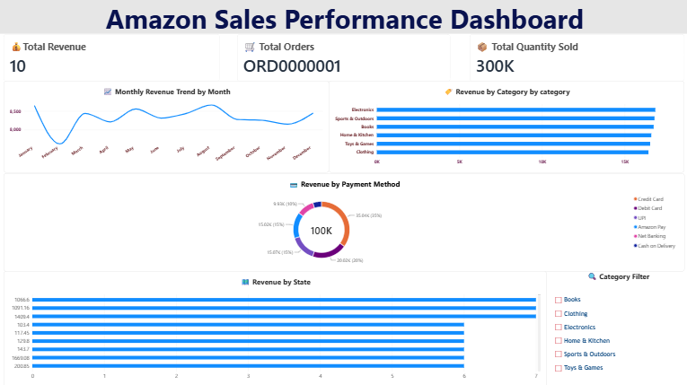

# Amazon Sales Performance Dashboard

An interactive Power BI dashboard built to analyze Amazon sales performance using sales, revenue, product category, payment method, and regional data.

## Dashboard Overview

The dashboard provides a complete view of Amazon sales performance through interactive visuals and KPIs.

### Key Features

- Total Revenue KPI
- Total Orders KPI
- Total Quantity Sold KPI
- Monthly Revenue Trend
- Revenue by Product Category
- Revenue by Payment Method
- Revenue by State
- Interactive Category Slicer

## Tools Used

- Power BI Desktop
- Power Query
- DAX
- Data Visualization
- Microsoft Power BI

## Data Cleaning and Preparation

The raw Amazon sales dataset was cleaned and transformed using Power Query.

Steps performed:

- Removed blank rows
- Removed duplicate records
- Corrected data types for dates, text, and numeric columns
- Filtered records with missing seller information
- Created a calculated Revenue column using Quantity and Unit Price
- Created Net Revenue after applying discounts

## Dashboard Visuals

### KPI Cards

- Total Revenue
- Total Orders
- Total Quantity Sold

### Charts

- Monthly Revenue Trend: Line chart
- Revenue by Category: Bar chart
- Revenue by Payment Method: Donut chart
- Revenue by State: Column chart

### Interactive Filter

- Category Slicer: Allows users to filter the entire dashboard by product category

## Key Insights

- Identified the highest-revenue product categories
- Analyzed monthly sales trends across the available period
- Compared revenue contribution across payment methods
- Identified regional performance using state-wise revenue
- Enabled dynamic filtering to analyze individual product categories

## Dashboard Preview

## Project Files

| File | Description |
| `Amazon_Sales_Performance_Dashboard.pbix` | Power BI dashboard file |
| `Amazon_Sales_Dashboard_Screenshot.png` | Dashboard preview image |
| `amazon_sales_data.csv` | Amazon sales dataset |
| `README.md` | Project documentation |

## How to Use

1. Download the `Amazon_Sales_Performance_Dashboard.pbix` file.
2. Open it using Power BI Desktop.
3. Use the Category slicer to filter the dashboard.
4. Explore revenue, orders, quantity, categories, payment methods, and state-wise performance.

## Skills Demonstrated

- Data cleaning and transformation
- Data modeling
- Power Query
- DAX calculations
- Dashboard design
- Data visualization
- Business intelligence analysis
